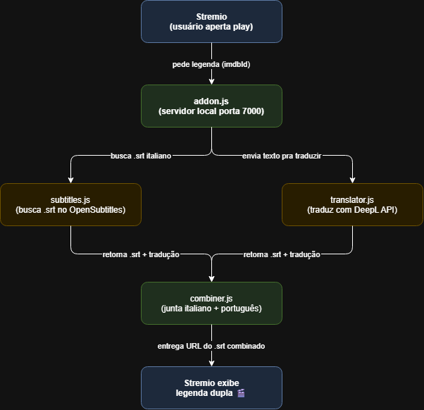

# Stremio Dual Sub

Add-on para o Stremio que gera legendas duplas automaticamente para estudo de idiomas, exibindo o texto original (**italiano**) na linha superior e a tradução (**português**) destacada na linha inferior.

## Como funciona

1. **Busca e Ranqueamento:** Ao iniciar um filme ou série no app, o add-on consulta a API do OpenSubtitles e utiliza o **Índice de Jaccard** para comparar o nome do arquivo de vídeo com as legendas disponíveis, escolhendo a mais similar. 
2. **Tratamento de Encoding:** Descompacta o arquivo `.gz` e detecta automaticamente arquivos antigos em `Windows-1252` (convertendo para `UTF-8` via biblioteca `iconv-lite`) para evitar quebra de acentos.
3. **Tradução em Lote:** Divide os diálogos em lotes de 50 falas e envia para uma instância local do **LibreTranslate**, reduzindo o tempo de processamento.
4. **Formatação:** Combina os dois idiomas em um único arquivo `.srt` com diferenciação visual por cor.




## Tecnologias utilizadas

* **Node.js** e **Stremio Add-on SDK** - Ambientes de execução do projeto.
* **LibreTranslate** - API local de tradução.
* **srt-parser-2** e **iconv-lite** - Bibliotecas de parsing de legendas e tratamento de encoding.


## Pré-requisitos

* [Node.js](https://nodejs.org) instalado
* [LibreTranslate](https://github.com/LibreTranslate/LibreTranslate) instalado via Python (`pip install libretranslate`)


## Como rodar localmente

1. Clone o repositório e instale as dependências:
   ```bash
   npm install
   ```

2. **Terminal 1** — Inicie o servidor local do LibreTranslate:
   ```bash
   libretranslate --load-only en,it,pb
   ```
   *(Nota para Windows: certifique-se da pasta `Scripts` do Python estar nas variáveis de ambiente `PATH`, caso não, execute usando o caminho completo do executável, ex.: `& "C:\Users\<SEU_USUARIO>\AppData\Local\Programs\Python\Python313\Scripts\libretranslate.exe" --load-only en,it,pb`)*

3. **Terminal 2** — Inicie o servidor do add-on:
   ```bash
   node src/addon.js
   ```

4. **Instale no Stremio:** Abra o Stremio, vá na aba **Add-ons**, cole o link abaixo na barra de pesquisa e clique em **Instalar**:
   ```text
   http://127.0.0.1:7000/manifest.json
   ```

## Melhorias futuras

* Permitir configurar os idiomas de origem e destino diretamente na instalação do add-on.
* Adicionar cache persistente para evitar retraduzir legendas já processadas.
* Realizar o deploy em nuvem para acesso público sem depender de servidor local.
  * Após deploy em nuvem, adicionar limpeza automática de cache antigo na pasta `legendas/`.
